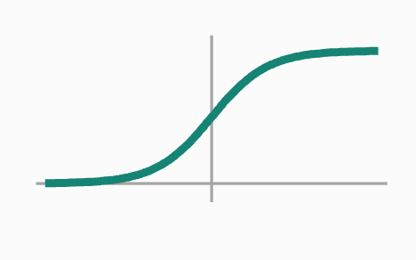
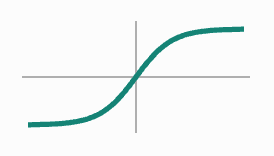
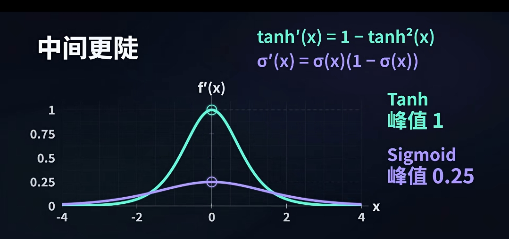
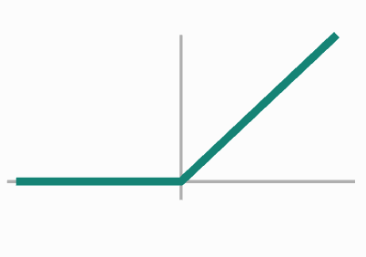
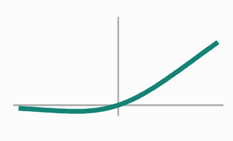
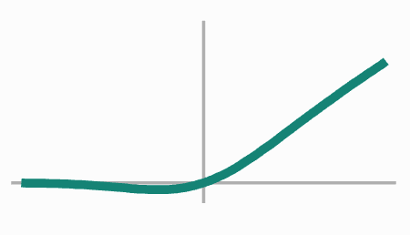
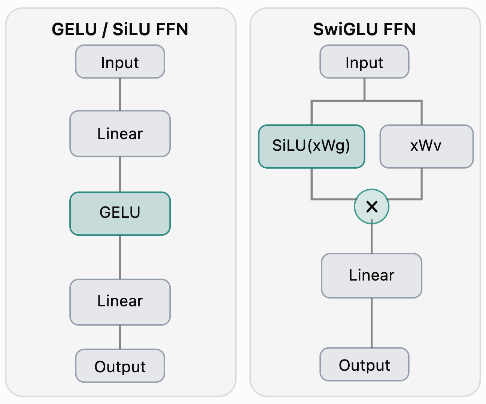

# 原理

激活函数主要是为了在神经网络中引入非线性。

# Sigmoid

这是人类早期使用的激活函数（BTW，之所以叫 `sigmoid` ，是因为它是 `S` 形状的）：

$$
\sigma(x) = \frac{1}{1 + e^{-x}}
$$

形状如下：

有很多的非线性模型，为什么偏偏选了 `sigmoid` 呢？我觉得是因为它和生物界神经元的激活非常像：光滑连续有界，而且它的导数很好求，是可以根据激活值直接进行计算的：

$$
\sigma'(x) = \sigma(x) (1 - \sigma(x))
$$

但是 sigmoid 在后续的训练出现了两个问题：

- 梯度过小，在 0 附近梯度最大，仅为 `0.25` ，而到了两端，梯度甚至趋于 `0` 。这很容易导致梯度消失。
- 值域过小，而且只为正数。

# Tanh

正是因为 `sigmoid` 的缺陷，人们提出了 `tanh` 做激活函数：

$$
\tanh(x) = \frac{e^{x} -  e^{-x}}{e^{x} + e^{-x}}
$$

形状如下：

相比于 `sigmoid` ，它具有正负值域，而且它的导数的值域也更大：

但是依然没有解决梯度消失的问题。

# ReLU

ReLU 是 Rectified Linear Unit 的意思，Rectified 借用了信号处理中的整流概念：把负输入截断为 0，保留正输入：

$$
\operatorname{ReLU}(x) = \max(0, x)
$$

形状是：

它简单粗暴的解决了梯度消失的问题，现在导数在大于 `0` 的时候就都是 `1` 了。

但是它也引入了一些问题：它的导数并不是连续的了，也就是它并不光滑。可能在数值上，只是少了 `0.001` ，但是梯度可以立刻从 `1` 变成了 `0` 。

# SiLU/GELU

SiLU 其实就是 Sigmoid Linear Unit 的意思，它在线性映射的基础上，增加了一个使用 `sigmoid` 的系数：

$$
\operatorname{SiLU}(x) = \sigma(x) \odot x
$$

形状是：

可以看到此时相比于 `relu` 它光滑了，而且它甚至不单调了，这种不单调，似乎再训练中也有优势。

GELU(Gaussian Error Linear Unit) 也是类似的设计需求：

$$
\operatorname{GELU}(x)=\Phi(x) \odot x
$$

其中 $\Phi(x)$ 是标准高斯分布（正态分布）的累积分布函数。形状是：

# SwiGLU

SwiGLU 就是 Swish + Gated Linear Unit。Swish 就是 `silu` ，而 gated 指的是门控结构（Gating Mechanism），不仅计算出一个信息，还会计算出一个系数，决定这条信息应该被保留多少：

$$
\operatorname{SwiGLU}(x) = \operatorname{Swish}(xW_g)\odot(xW_v)
$$

虽然 `silu` 也有点乘结构，但是它的门控信号 $\sigma(x)$ 和输出信号 $x$ 是“同时增长，同时减少”的，是不独立的。而 `swiglu` 则不会这样。

在网络结构上，二者对比如下：

